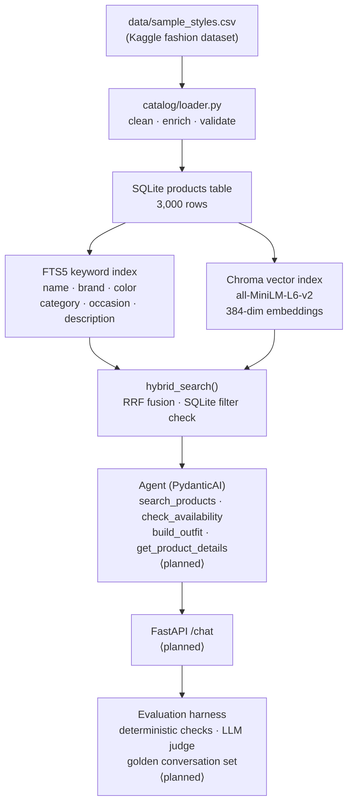

# StyleScout

A conversational fashion shopping assistant that searches a product catalog using
hybrid retrieval (keyword + vector + reciprocal rank fusion) and returns grounded
recommendations — no invented products, prices, or availability claims.

**Status:** data pipeline and retrieval layer complete.
Agent, API, evaluation framework, and experiments are not yet built.

---

## Why this project

General-purpose language models can suggest outfit ideas, but they cannot tell you
whether a specific item is in stock in your size, or what it actually costs. Grounded
product search requires structured data, not just fluent text generation.

This project builds the complete pipeline: a catalog in SQLite, a hybrid retrieval
layer with measured precision, an LLM agent that is only allowed to quote facts
retrieved from the catalog, a deterministic evaluation harness, and a calibrated
LLM-as-judge. The goal is to show the full stack — retrieval, grounding, evaluation,
and experiment-driven improvement — with honest measurements at each step.

---

## Architecture



The parts marked `⟨planned⟩` are specified in `docs/SPEC.md` but not yet implemented.

---

## How hybrid search works

**Keyword path (BM25):** query tokens are sanitized, stripped of stopwords, and looked
up against an SQLite FTS5 index that covers all six text fields. Results are ranked by
BM25 score.

**Vector path (cosine similarity):** the query is embedded with `all-MiniLM-L6-v2` and
searched against a Chroma collection of pre-embedded product documents.

**Reciprocal rank fusion:** the two ranked lists are merged with RRF
(`score = Σ weight / (k + rank)`, default k = 60). A product that appears high in both
lists scores higher than one that appears in only one.

**Authoritative filter check:** after fusion, all candidates are re-checked against the
SQLite `products` table. This is the only source of truth for price, color, size stock,
and availability. The vector index stores a subset of metadata as an optimisation to
reduce candidate volume, but it is never trusted for constraint enforcement.
Size filtering requires parsing a JSON column (`sizes`) that cannot be expressed as a
Chroma where-clause, so the SQLite check is mandatory for correctness.

For a worked comparison of all three retrieval methods on four representative queries,
see `docs/DECISIONS.md` (D7).

---

## Tech stack

| Area | Choice |
|------|--------|
| Language | Python 3.12 |
| Package manager | uv (lockfile committed) |
| Structured data | SQLite + FTS5 |
| Vector store | Chroma (local persistent) |
| Embeddings | all-MiniLM-L6-v2 via ONNX (no PyTorch) |
| Agent framework | PydanticAI — *planned* |
| API | FastAPI, async — *planned* |
| Observability | OpenTelemetry + Logfire — *planned* |
| Testing | pytest + pytest-asyncio |
| Lint / format | ruff |

---

## Getting started

**Prerequisites:** Python 3.12, [uv](https://docs.astral.sh/uv/).

```bash
git clone <repo>
cd style-scout
uv sync --extra dev
```

**Download the dataset.**
The catalog is built from the
[Fashion Product Images (Small)](https://www.kaggle.com/datasets/paramaggarwal/fashion-product-images-small)
dataset on Kaggle. Download `styles.csv` and place it at `data/raw/styles.csv`.
Check the license on the dataset page before use.

**Build the catalog and indexes:**

```bash
uv run stylescout build-catalog   # loads data/raw/styles.csv → data/catalog.db
uv run stylescout build-index     # embeds 3,000 products → data/chroma/  (~2 min)
```

**Run the test suite and linter:**

```bash
uv run pytest
uv run ruff check .
```

> `build-index` re-embeds the full catalog on every run. Re-run it only after
> changing the catalog or the embedding model.

---

## Data

The catalog is drawn from the
[Fashion Product Images (Small)](https://www.kaggle.com/datasets/paramaggarwal/fashion-product-images-small)
dataset (Kaggle). Check the license on the dataset page before redistribution.

The raw dataset provides product names, categories, colors, brands, and usage tags.
The following fields are **synthetic**, generated with a fixed random seed:

- `price_eur` — random prices; not realistic for any real product.
- `sizes` — random stock quantities per size.
- `in_stock` — derived from the synthetic sizes.
- `description` — template-generated text used for embeddings.

Do not treat any price or availability figure in this catalog as real.

---

## Testing

```bash
uv run pytest          # 98 tests, 1 deselected (slow ONNX model tests)
uv run ruff check .    # lint
```

| Test file | What it covers |
|-----------|---------------|
| `test_loader.py` | Schema validation, deduplication, derived fields |
| `test_search.py` | FTS tokenisation, stopword removal, filter-only fallback, injection safety, index coverage |
| `test_embeddings.py` | Product text construction, Chroma upsert and query |
| `test_hybrid.py` | RRF math, SQLite filter confirmation, full hybrid pipeline, filter-only fallback |
| `test_generator.py` | Synthetic price and size generation |
| `test_sample_dataset.py` | Dataset sampling and category mapping |

Tests marked `slow` require the real ONNX model and are skipped by default.
Run them with `uv run pytest -m slow`.

---

## Design decisions

Key decisions recorded in [`docs/DECISIONS.md`](docs/DECISIONS.md):

- **D5** — Chroma chosen as the local vector store (over Qdrant, pgvector, FAISS).
- **D6** — `all-MiniLM-L6-v2` for embeddings: lightweight, local, no API cost.
- **D7** — FTS5 with OR matching and BM25; trade-offs vs. AND matching; where hybrid beats keyword-only and vector-only.
- **D8** — User input is quoted as FTS5 literals, never parsed as syntax; parameterised SQL throughout.
- **D9** — FTS index covers all six text fields; empty or stopword-only queries fall back to filter-only results.
- **D10** — Known data quality limitations (see below).

---

## Known limitations

- **OR-matching noise.** Keyword search uses OR so "black sneakers" can surface black
  sunglasses and earrings. Hybrid search reduces this but does not eliminate it.
  Recall will be measured in the retrieval evaluation (planned).

- **Mixed category granularity.** The "dress" category includes sarees, kurtis,
  nightdresses, and kids' items because the source dataset does not distinguish them
  at the category level used here. Gender and age columns from the raw data are not
  carried through the schema.

- **English-only stopwords.** The stopword list covers common English function words.
  Multi-language queries or queries that are stopword-heavy in other languages will
  fall through to filter-only results.

- **Synthetic data.** Prices, sizes, stock levels, and descriptions are generated, not
  real. Two products with the same name may have very different prices. Evaluation
  results measure the system on this catalog only.

- **Embeddings are at cosine distance 0.2–0.6 for all queries tested.** The
  all-MiniLM-L6-v2 model was trained mostly on English text; fashion-specific
  terminology and non-English queries may yield lower-quality results.

---

## Roadmap

The retrieval layer is complete. The remaining milestones from the project spec are:

**Agent (next).** A PydanticAI agent with four typed tools: `search_products`,
`check_availability`, `get_product_details`, and `build_outfit`. Every recommended
product ID will be validated against the catalog before it reaches the user.

**API.** A FastAPI `/chat` endpoint with structured `AgentResponse` output,
per-session conversation history, and request tracing.

**Evaluation harness.** A golden conversation set (≥ 40 conversations across six
scenario categories), deterministic grounding and constraint checks, and a
calibrated LLM-as-judge with Spearman/kappa agreement against human labels.

**Experiments.** At least three agent variants (baseline prompt, improved prompt,
query rewrite or model change) evaluated on the golden set. Results table with
deterministic metrics, judge scores, latency, and cost per conversation.

None of the above is implemented yet.

---

## Working with coding agents

The project follows a spec-first, plan-first workflow. `docs/SPEC.md` is the source of
truth; if the code and the spec disagree, work stops until the discrepancy is resolved.
Every non-trivial task begins with a written plan that is reviewed before any code is
written. Tests serve as the acceptance criteria: a task is not complete until the test
suite passes and ruff reports no errors.

Every agent-written diff is reviewed by the owner before it is accepted. Design
decisions, wrong turns, and corrections are recorded in `docs/DECISIONS.md` and
`docs/AGENT_LOG.md` so the project history stays legible.
